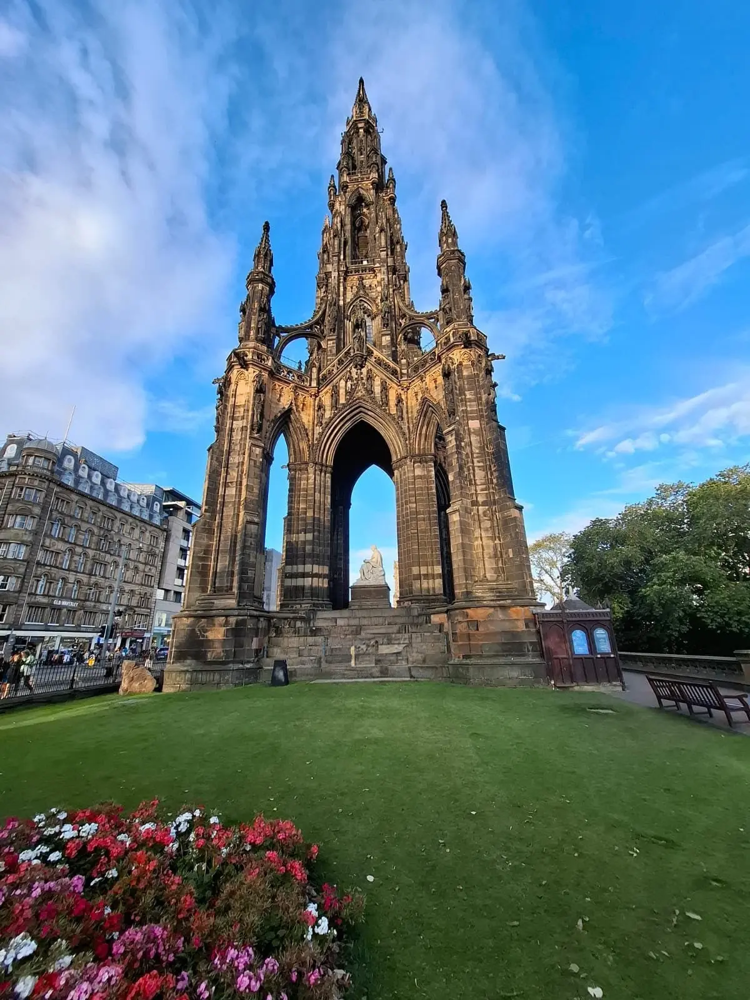
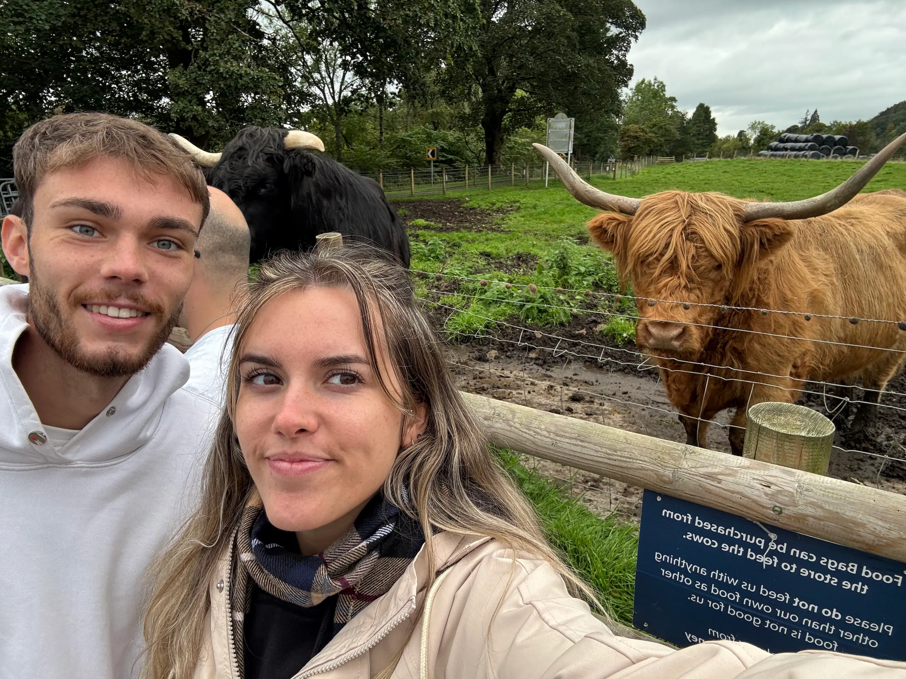
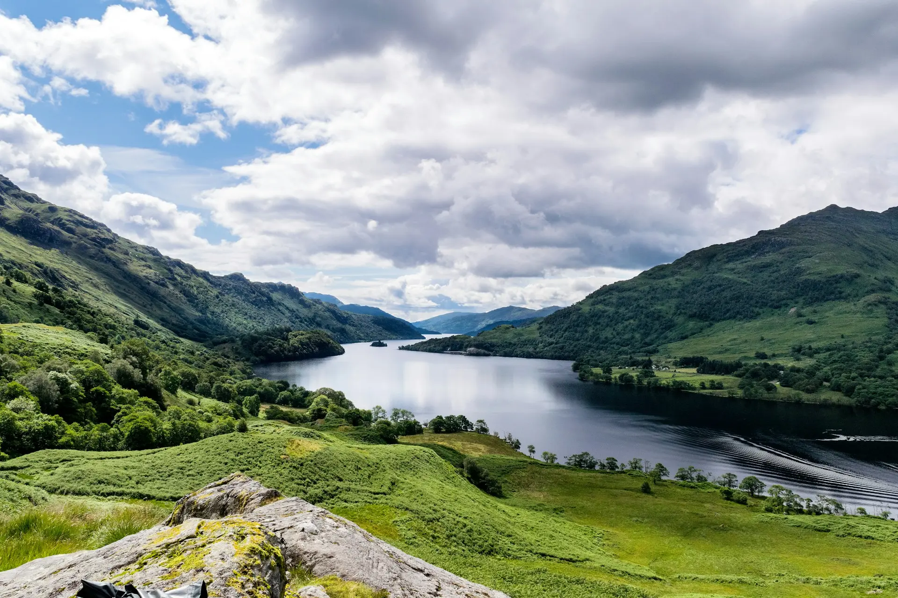
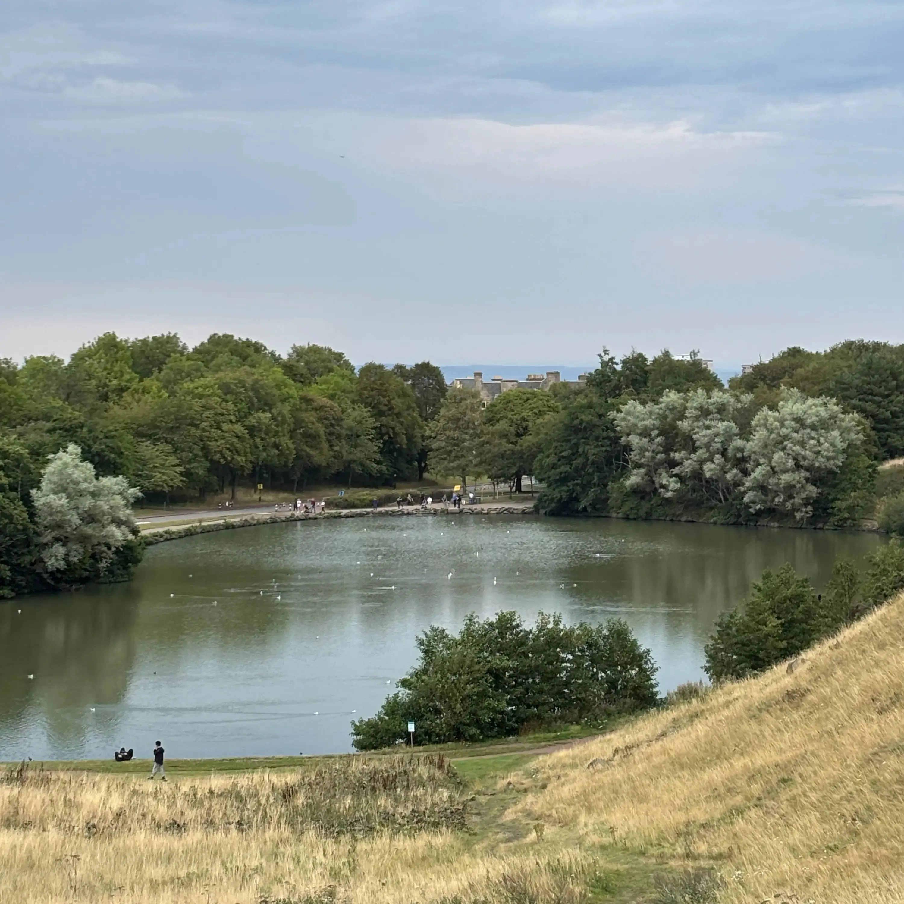
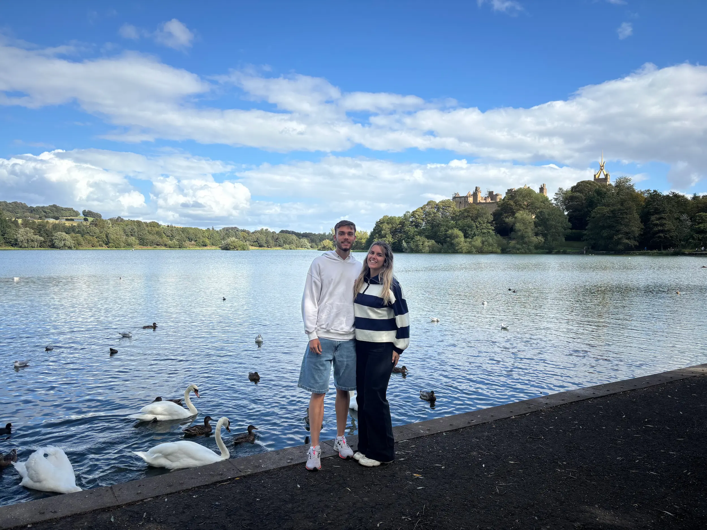
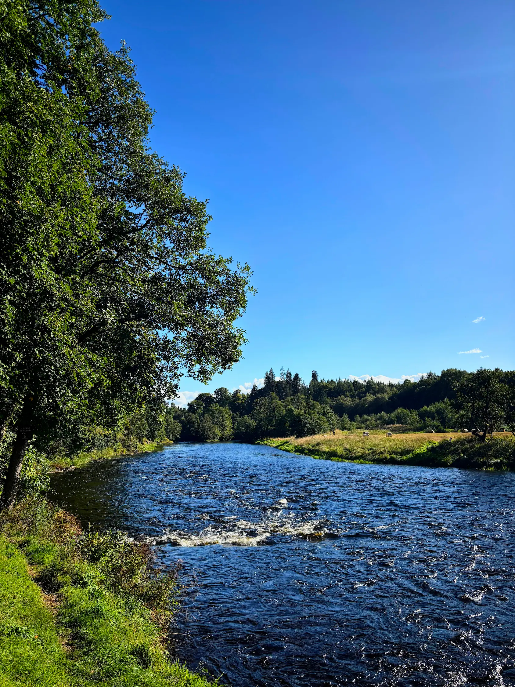
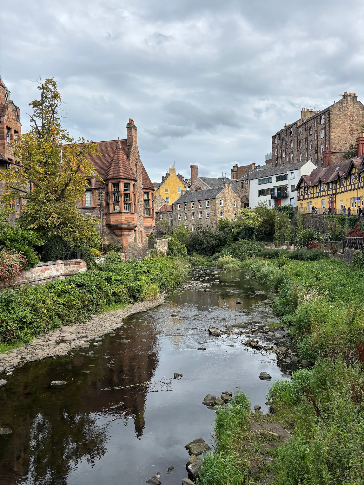

A primera vista, seis días parecen demasiados para una ciudad que se recorre a pie. Pero Edimburgo funciona como campamento base: desde aquí salen las excursiones a las **Highlands**, al **Lago Ness** y a media docena de castillos escoceses.

Este es el itinerario que seguimos nosotros en nuestros seis días: cuatro en la ciudad y dos fuera de ella. Si no dispones de tantos días, te recomendamos echar un vistazo a nuestra [guía de qué ver en Edimburgo en 3 días](/blog/edimburgo-en-3-dias), donde condensamos lo esencial para una visita más corta.

## Día 1: Introducción al casco antiguo

Nosotros recomendamos empezar a recorrer la ciudad con un free tour. Te ayudará a conocer la historia de Edimburgo desde sus orígenes medievales y descubrirás anécdotas que te ayudarán a contextualizar todo lo que verás los próximos días. Durante esas dos horas, recorrerás los principales puntos de interés:

- La **Royal Mile**, la calle más famosa, que conecta el Castillo de Edimburgo con el Palacio de Holyroodhouse.
- La **Catedral de St Giles**, con su arquitectura gótica y una historia que se remonta al siglo XII.
- **Victoria Street**, una calle colorida que inspiró a J.K. Rowling para crear el Callejón Diagon en Harry Potter.
- **The Real Mary King's Close**, un laberinto subterráneo que revela la vida cotidiana de los antiguos habitantes de Edimburgo.
- El **Parlamento Escocés**, un edificio moderno que contrasta con el entorno histórico.
- **Greyfriars Kirk**, una iglesia con siglos de historia y un cementerio lleno de leyendas.

Terminarás el tour muy cerca del museo de Edimburgo, donde puedes entrar gratis para conocer más sobre la historia de la ciudad. A nosotros nos gustó porque tenía algunas salas interesantes. Además, el edificio tiene un mirador gratuito con vistas a toda la ciudad.

Por la tarde, visita el **Walter Scott Monument**, una torre gótica que domina los Princes Street Gardens y rinde homenaje al escritor escocés.

## Día 2: El Castillo de Edimburgo

Empieza el día visitando el **Castillo de Edimburgo**, la fortaleza que domina la ciudad desde Castle Rock. Es un castillo bastante grande, así que te llevará toda la mañana verlo todo.

> [!WARNING/No te quedes sin entrada]
> Compra las entradas online con varios días de antelación: cuando se agotan en la web, no venden más en el castillo. Además, te evitará colas al entrar.
>
> Cuando organizamos tu viaje, nos encargamos de reservar las entradas para el día y la hora que encajan en tu ruta, así que no tienes que estar pendiente de que se agoten.

Desde los muros del castillo verás toda la ciudad, los Jardines de Princes Street y, a lo lejos, el **Firth of Forth**. No te pierdas el cañonazo de las 13:00, una tradición que se mantiene desde 1861 para que los barcos del puerto sincronizaran sus relojes.

Por la tarde, visita alguna destilería o whisky bar para aprender sobre el "agua de vida" escocesa y probar diferentes variedades. Nosotros fuimos a **The Scotch Whisky Experience**, donde hicimos un tour guiado que incluye una cata de varios tipos de whisky.

## Día 3: Excursión a las Highlands y Lago Ness

El tercer día toca alejarse de la ciudad y descubrir las **Tierras Altas** escocesas. Nosotros reservamos una excursión de día completo al Lago Ness, las Highlands y el valle de Glencoe.

El recorrido atraviesa montañas, lagos de aguas oscuras y valles verdes. Y todo con un guía que comparte historias sobre clanes escoceses, batallas históricas y leyendas locales que dan vida a cada lugar.

Hasta llegar al Lago Ness hay varias paradas en el camino para hacer fotos: montañas que se reflejan en lagos tranquilos y castillos en ruinas junto a la carretera.

Después llegamos al **Lago Ness**, donde nos dejaron unas horas libres para visitar la zona. Nosotros cogimos un crucero para adentrarnos en sus aguas, y mereció mucho la pena.

Por último, llegamos al valle de **Glencoe**, el más fotogénico de Escocia, con montañas que se alzan a ambos lados de la carretera. El paisaje se parece mucho al de Islandia, sobre todo cuando las nubes bajas se enganchan entre los picos.

> [!NOTE/Prepárate para un día largo]
> La excursión dura todo el día, de 07:30 a 19:30, con varias horas de autobús. Si buscas algo más tranquilo, échale un vistazo a nuestra guía de [excursiones desde Edimburgo](/blog/excursiones-desde-edimburgo) para ver otras opciones.
>
> Si prefieres no pasar el día en un autobús, al diseñar tu ruta podemos cambiar la excursión por un coche de alquiler y una noche en las Highlands, y nos encargamos de todas las reservas.

## Día 4: Explorando los alrededores

Después del día intenso en las Highlands, el cuarto día va a un ritmo más relajado. Tómate el tiempo necesario para subir a **Arthur's Seat**, la colina volcánica que se eleva 251 metros sobre el nivel del mar y desde la que se ven las mejores vistas de Edimburgo.

La subida y la bajada llevan entre 2 y 3 horas, según tu ritmo y el tiempo que pases en la cima. Hay varias rutas para llegar arriba, y desde todas se ve la ciudad entera y el mar.

Por la tarde o al atardecer, únete a un free tour nocturno que te mostrará Edimburgo desde otra perspectiva. Estos tours suelen incluir historias de fantasmas, leyendas urbanas y los rincones más misteriosos de la ciudad.

Si el tiempo lo permite o prefieres un plan más tranquilo, este es un buen día para explorar tiendas locales, buscar souvenirs de calidad y tomar un afternoon tea en alguno de los salones de té de Edimburgo.

## Día 5: Ruta por castillos escoceses y Glasgow

El quinto día alquilamos un coche para recorrer varios sitios históricos alrededor de Edimburgo. Recoge el coche temprano y prepárate para un día completo: la ruta suma unas 3 horas y media de conducción, pero con bastantes paradas.

La primera parada es el **Castillo de Blackness**, una fortaleza del siglo XV con forma de barco a orillas del Firth of Forth. Sirvió de escenario en la serie Outlander y conserva una atmósfera medieval auténtica.

Continúa hacia **Linlithgow**, una pequeña ciudad con un lago con vistas al palacio. Aunque no recomendamos entrar, el palacio es muy bonito por fuera: una ruina que conserva su grandeza renacentista y permite imaginar la vida de la antigua realeza escocesa.

El siguiente destino es el **Castillo de Stirling**, uno de los más importantes de la historia de Escocia. Puedes comprar las entradas online cuando llegues o directamente en taquilla. Dedica al menos 2 horas a explorar este castillo, testigo de batallas cruciales por la independencia escocesa.

Después, hicimos una breve parada en **Doune** para ver su castillo por fuera, también famoso por aparecer en Outlander y Monty Python. Aun así, lo que más nos gustó de Doune fue el río y el paisaje natural que lo rodea, ideal para dar un paseo si el tiempo te respeta.

Para terminar, nosotros fuimos a **Glasgow**, la ciudad más grande de Escocia, y sinceramente no nos gustó nada. Visitamos la catedral y dimos un paseo por el centro, pero no nos pareció una ciudad atractiva comparada con Edimburgo, así que no la recomendamos en este itinerario.

## Día 6: Rincones secretos y despedida

Tu último día completo en Edimburgo sirve para descubrir los rincones más pintorescos y menos turísticos de la ciudad. Comienza la mañana con un paseo hasta **Dean Village**, un antiguo pueblo de molineros a media hora andando desde el centro.

Dean Village parece sacado de un cuento, con sus edificios de piedra del siglo XIX, puentes arqueados y el río Water of Leith. No te pierdas el **Dean Bridge**, el viaducto que diseñó Thomas Telford en 1832.

Desde aquí, sigue el **Water of Leith Walkway**, un paseo fluvial que serpentea por zonas verdes, cascadas y rincones tranquilos alejados del bullicio turístico. Es el lugar perfecto para disfrutar de la naturaleza en plena ciudad.

Por la tarde, sube a **Calton Hill** para ver la puesta de sol desde uno de los miradores más conocidos de Edimburgo. En la colina encontrarás varios monumentos, incluido el National Monument (inspirado en el Partenón de Atenas) y el Nelson Monument.

Las vistas de 360 grados abarcan toda la ciudad, Arthur's Seat, el Castillo, el mar y las colinas de alrededor. Es el lugar perfecto para despedirte de Edimburgo mientras ves el atardecer.

## Consejos para tu visita a Edimburgo

### Transporte en Edimburgo y alrededores

Edimburgo es una ciudad muy caminable, especialmente el casco antiguo, donde se concentran la mayoría de las atracciones. Las distancias son cortas y caminar te permite descubrir callejones, sus famosos _closes_ (pasajes) históricos y vistas inesperadas.

Los autobuses de **Lothian Buses** cubren toda la ciudad. El billete sencillo cuesta 2,40£ (unos 2,80€) y se compra al conductor; si vas a coger varios al día, sale más a cuenta un billete de día con viajes ilimitados.

Para excursiones fuera de Edimburgo, tienes varias opciones. En nuestro artículo sobre [las mejores excursiones desde Edimburgo](/blog/excursiones-desde-edimburgo) te contamos en detalle las distintas opciones y cuál elegir según adónde vayas.

> [!WARNING/Nota importante]
> Los precios, horarios y normativas pueden cambiar. Verifica siempre en webs oficiales antes de tu viaje.

### Dónde comer en Edimburgo

Siendo sinceros, la gastronomía escocesa no es la mejor que hemos probado, ni está cerca de serlo. Sin embargo, tiene algunos platos y postres típicos que merece la pena probar al menos una vez:

- **Haggis:** El plato nacional por excelencia, hecho con vísceras de oveja, avena y especias. No es para todos los paladares, pero a nosotros nos gustó bastante.
- **Cullen Skink:** Una sopa de pescado ahumado, perfecta para entrar en calor después de un día de caminata.
- **Fish & Chips:** El clásico. El mejor de la ciudad (y el más famoso) está en **Bertie's Proper Fish & Chips** (en Victoria Street) o en **The Fishmarket**, en el puerto de Newhaven.
- **Cranachan:** El postre tradicional por excelencia, hecho con avena, whisky, frambuesas y nata.

**Nuestros pubs históricos favoritos:**
Para comidas auténticas, los pubs son la mejor opción. Una comida en estos sitios cuesta **17-26£ (unos 20-30€)** por persona. Algunos de nuestros favoritos son:

- **The Piper's Rest:** Comida tradicional escocesa con música en directo y ambiente genial.
- **The Sheep Heid Inn:** Uno de los pubs más antiguos de Escocia, con una antigua bolera de madera dentro.
- **The Devil's Advocate:** Escondido en uno de los _closes_, ideal para probar cervezas artesanales y elegir entre cientos de whiskies.

### Cuánto cuesta viajar a Edimburgo

Edimburgo puede ser una ciudad cara, pero con un poco de planificación puedes disfrutarla sin pasarte de presupuesto.

En nuestro artículo sobre [cuánto cuesta viajar a Edimburgo](/blog/cuanto-cuesta-viajar-edimburgo) te contamos cuánto cuesta cada aspecto del viaje y cómo ahorrar sin renunciar a lo esencial.

## Edimburgo en 6 días: lo que nos llevamos

Seis días en Edimburgo dan para mucho más que la Royal Mile. Lo que hace que este itinerario funcione son los dos días fuera: las Highlands y la ruta de castillos enseñan la Escocia que no cabe en una ciudad.

Y si tuviéramos que recortar algo, sería la parada en Glasgow, que no nos convenció. Con ese rato de más, el día 5 se queda en castillos y paisaje, que es lo que de verdad vale la pena.

### ¿Quieres este viaje, pero mejorado?

En **Kilómetros por Explorar** diseñamos tu ruta por Escocia desde cero y nos encargamos de reservarlo todo: vuelos, alojamiento, la excursión a las Highlands, el coche de alquiler y las entradas a los castillos.

Además, te recomendamos dónde comer bien gastando poco y te entregamos el viaje completo en una app móvil. Tienes más ideas para tu escapada en nuestra página de [Edimburgo](/destinos/edimburgo).

[Reserva aquí tu videollamada gratuita de diagnóstico](/contacto)
