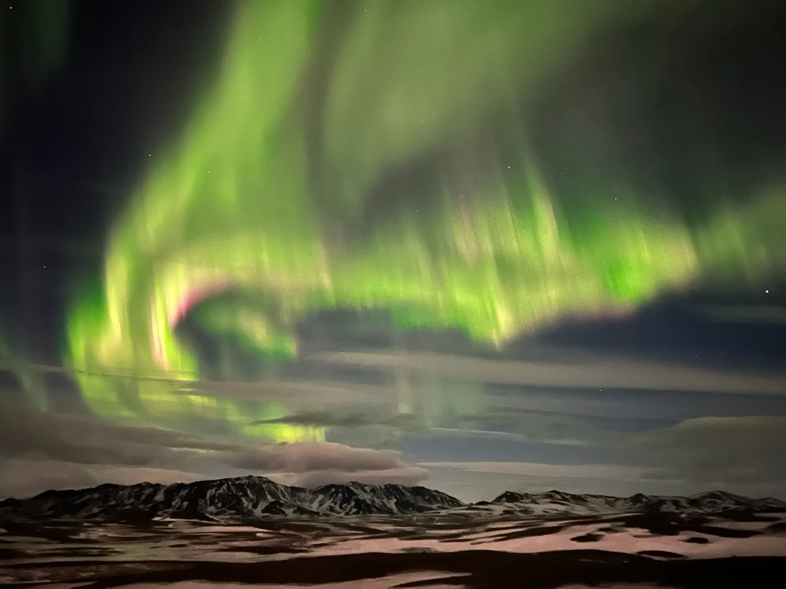
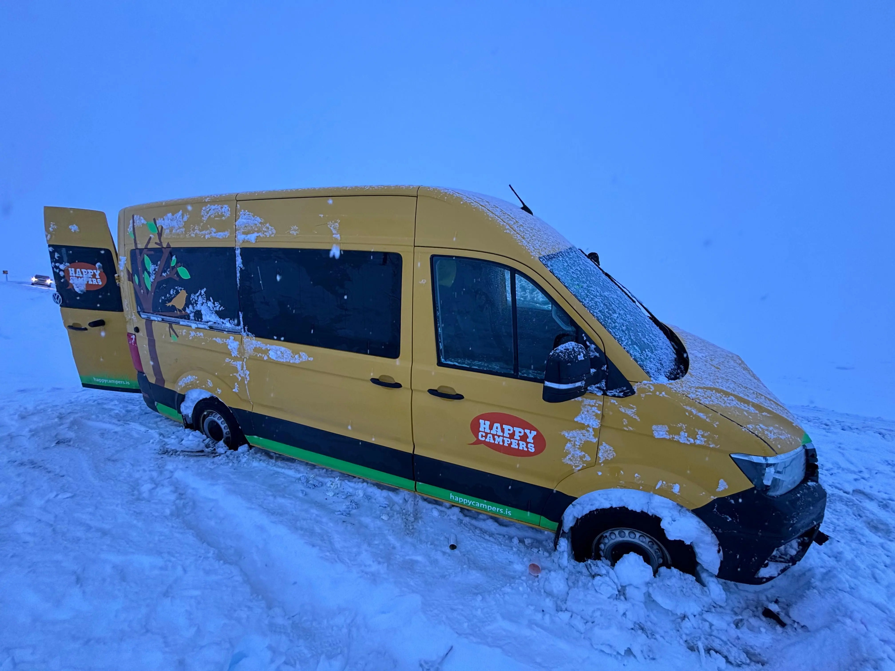

Islandia es uno de esos destinos que te obsesionan. Después de nuestro primer viaje en febrero, pasamos meses mirando fotos, viendo vídeos y preguntándonos cómo sería la isla en verano. Así que cuando tuvimos la oportunidad de volver en julio, no lo dudamos.

Ahora, habiendo experimentado Islandia en sus dos extremos - el frío oscuro del invierno y el sol de medianoche del verano - puedo decir con conocimiento de causa que son viajes completamente diferentes. Tan diferentes que casi parecen dos países distintos.

La pregunta que más nos hacen es: "¿Cuándo es mejor ir a Islandia, en verano o en invierno?" Y nuestra respuesta siempre es la misma: ambos. Idealmente, deberías experimentar Islandia en las dos estaciones, cada una ofrece algo único que la otra no puede dar.

Pero entendemos que no todo el mundo puede permitirse dos viajes a Islandia (aunque, créenos, después del primero querrás volver), así que vamos a desglosar nuestra experiencia en ambas épocas para ayudarte a decidir cuál se adapta mejor a lo que buscas.

Elegir mal la fecha es el error nº1 que vemos en nuestros clientes. Mucha gente viaja en abril esperando ver frailecillos (que suelen llegar a finales de abril o principios de mayo) o en septiembre buscando cuevas de hielo (que aún están inundadas).

Vamos a ser honestos desde el principio: si tuviéramos que elegir solo una, nos quedaríamos con el invierno. Pero la diferencia es mínima, y hay argumentos sólidos para ambas opciones. El invierno islandés nos cautivó de una manera que no esperábamos, pero el verano tiene un encanto completamente diferente que también vale absolutamente la pena. Déjanos explicarte por qué.

## Luz y oscuridad: el factor más importante

Este es probablemente el factor más importante a considerar y el que más impacta tu experiencia. En nuestro viaje de invierno en febrero, teníamos unas 8-9 horas de luz al día. El sol salía alrededor de las 10:00 y se ponía sobre las 18:00.

Suena limitante, ¿verdad? Y lo es, pero de una manera que terminé amando. Esas horas de luz son preciosas, con esa luz baja, dorada, dramática.

Lo que realmente nos sorprendió fue que las "noches" largas no fueron aburridas. Aprovechamos las horas de oscuridad para conducir entre ubicaciones (las carreteras principales están bien iluminadas y mantenidas), cazar auroras boreales, relajarnos en aguas termales bajo las estrellas, y simplemente disfrutar de esa atmósfera única del Ártico nocturno.

Sí, tuvimos que planificar cuidadosamente para ver las cascadas y glaciares principales durante las horas de luz, pero esa limitación nos forzó a ser más selectivos y apreciar más cada lugar.

En julio, por el contrario, experimentamos el sol de medianoche. El sol nunca se ponía realmente, a medianoche había una especie de crepúsculo perpetuo con luz suficiente para leer un libro afuera. Al principio pensé que sería genial - más tiempo para ver cosas. Y lo fue, pero también fue extraño.

Tu reloj biológico se desorienta completamente. A las 23:00 miras el cielo luminoso y tu cuerpo no entiende que debería estar cansado. Necesitas antifaces para dormir a menos que te adaptes completamente.

La ventaja obvia del verano es que puedes hacer mucho más en un día. No estás limitado por las horas de luz. Puedes levantarte temprano, hacer actividades todo el día, y seguir explorando hasta las 23:00. Maximizas cada día de viaje. Para quienes tienen tiempo limitado y quieren ver lo máximo posible, esto es una ventaja.

## Auroras boreales vs sol de medianoche

Este es un punto decisivo para muchos viajeros. Las auroras boreales solo son visibles en oscuridad, así que el verano islandés con su luz perpetua las hace imposibles. En invierno, sin embargo, las auroras son una posibilidad real cada noche despejada.

Durante nuestro viaje en febrero, vimos auroras boreales en 3 de las 6 noches que pasamos fuera de Reykjavik. Una de esas noches estábamos en un campo nevado cerca de Jökulsárlón, a -4°C, completamente solos, y el silencio solo se rompía por nuestras exclamaciones de asombro. Es una experiencia que nos marcó profundamente.

Pero ojo, ver auroras no está garantizado. Necesitas cielo despejado, y el clima islandés es notoriamente impredecible. De las 8 noches totales de nuestro viaje, solo 3 tuvieron cielo despejado. Las otras estaban completamente nubladas. Así que aunque el invierno ofrece la posibilidad, no la certeza.

Si quieres saber cómo y dónde verlas, consulta [nuestra guía sobre los mejores destinos para ver auroras boreales](/blog/mejor-pais-auroras-boreales), donde compartimos consejos para maximizar las probabilidades.

El sol de medianoche del verano también es un fenómeno natural único, aunque menos impresionante que las auroras. Es surrealista estar despierto a las 01:00 con luz de día, hacer una caminata nocturna por cascadas, o ver el paisaje bañado en esa luz dorada especial que nunca termina. Es hermoso de una manera diferente.

Para nosotros, las auroras boreales son una experiencia más impactante y memorable que el sol de medianoche. Si este es tu primer viaje a Islandia y ver auroras está en tu lista de bucket list, ve en invierno sin dudarlo. El sol de medianoche es genial pero menos dramático.

## Accesibilidad y carreteras

Este es el argumento más fuerte a favor del verano. En nuestro viaje de febrero, varias carreteras estaban cerradas por nieve y hielo, y las F-roads (carreteras del interior) estaban completamente inaccesibles. Algunos lugares que queríamos visitar tuvieron que descartarse porque las condiciones no lo permitían.

Necesitábamos consultar road.is y safetravel.is diariamente para verificar el estado de las carreteras antes de planificar cada día. Además, tuvimos un pequeño susto con la camper y la nieve.

Nosotros alquilamos una camper en invierno (en nuestra opinión, mejor que un coche normal, la otra opción hubiera sido un 4x4). Aún así, conducir era estresante - caminos helados, ventiscas súbitas, viento lateral que podía empujar el coche, y esa sensación constante de estar a merced de los elementos. Es parte de la aventura, pero no para todos.

> [!WARNING/¿Te asusta conducir en invierno?]
> Es normal. El clima en Islandia cambia cada 5 minutos y Google Maps no siempre avisa de las carreteras cortadas por ventiscas.
>
> Cuando diseñamos tu viaje, planificamos la ruta con margen para los cambios de tiempo y nos encargamos de reservar el vehículo y los alojamientos.

En julio, por el contrario, conducir era como en cualquier otro lugar. Todas las carreteras secas y en buen estado, las F-roads estaban abiertas (pudimos explorar las Highlands) y no teníamos tanto estrés por el clima.

Incluso alquilamos un coche normal (no 4x4) y no tuvimos ningún problema. Pudimos llegar a lugares remotos sin preocuparnos por quedarnos atascados en la nieve.

La accesibilidad del verano significa que puedes ser más espontáneo. No necesitas planificar cada día con tanta precisión. Si el plan A no funciona, simplemente vas al plan B sin preocuparte por si las carreteras estarán abiertas. Hay una libertad en eso que aprecié mucho.

Pero aquí está el giro: la dificultad del invierno también fue parte de lo que lo hizo especial. Cada lugar que visitamos sentía como un logro. Superar las condiciones adversas para llegar a una cascada congelada o un glaciar nevado nos hizo apreciarlo más. No sé si habría sentido lo mismo en las condiciones fáciles del verano.

**Nuestra opinión:** Si es tu primer viaje a Islandia y quieres verlo todo sin complicaciones, el verano gana por goleada. Si buscas aventura y no te importan las limitaciones, el invierno ofrece una experiencia más intensa y memorable.

Si prefieres ver cómo se organiza una ruta por carretera, mira nuestra guía de [Islandia en 8 días](/blog/islandia-en-8-dias).

## Actividades exclusivas de cada estación

Cada estación tiene actividades que simplemente no puedes hacer en la otra, y esto puede ser decisivo dependiendo de lo que más te interese.

### Exclusivas del invierno

- **Cuevas de hielo glaciares:** Esta fue nuestra actividad favorita del viaje invernal. Las cuevas de hielo azul cristalino bajo el glaciar Vatnajökull solo son accesibles de mediados de noviembre a mediados de marzo, según la oficina de turismo de Vatnajökull. Caminar dentro de un glaciar, rodeado de hielo azul brillante con luz filtrándose desde arriba, es absolutamente surrealista. En verano estas cuevas se inundan y colapsan, simplemente no existen.
- **Auroras boreales:** Ya mencionadas, pero merecen estar en esta lista otra vez porque son la actividad invernal por excelencia.

### Exclusivas del verano

- **Avistamiento de ballenas:** Las ballenas migran a aguas islandesas en verano. Los operadores de Húsavík, como North Sailing, reportan avistamientos en más del 90% de sus salidas (95,76% en 2025, de marzo a noviembre). En invierno las probabilidades bajan.
- **Frailecillos:** Estas aves adorables llegan a Islandia a finales de abril o principios de mayo y se marchan a mediados o finales de agosto, por lo que en invierno no las verás.
- **Highlands y F-roads:** Regiones completas del interior solo accesibles en verano cuando la nieve se derrite.
- **Senderismo serio:** Trekkings de varios días como Laugavegur solo son factibles en verano cuando los refugios están abiertos.

Las aguas termales se disfrutan en ambas estaciones, aunque admito que flotar en agua a 38°C cuando fuera hace -5°C tiene un factor especial que no tiene hacerlo con 15°C exterior.

**Nuestra opinión:** Depende totalmente de tus prioridades. Para nosotros, las cuevas de hielo y auroras del invierno superan a las ballenas y frailecillos del verano, pero entendemos que para otros sea al revés. Si eres fan de las aves o quieres hacer senderismo serio, verano.

> [!WARNING/Nota importante]
> Los precios, horarios y normativas pueden cambiar. Verifica siempre en webs oficiales antes de tu viaje.

## Temperatura y clima

Aquí viene una sorpresa: Islandia en invierno no es tan fría como esperábamos. Gracias a la corriente del Golfo, las temperaturas en la costa sur (donde está la Ring Road) raramente bajan de -10°C. Durante nuestro viaje de febrero, las temperaturas oscilaron entre -5°C y +2°C. Frío, sí, pero manejable con ropa adecuada.

El verdadero enemigo en invierno no es el frío sino el viento. El viento islandés es brutal - puede hacer que -2°C se sientan como -15°C. Hubo momentos donde el viento era tan fuerte que literalmente no podíamos abrir las puertas del coche.

Las cascadas que queríamos admirar teníamos que verlas rápido porque el viento nos congelaba la cara. Lleva múltiples capas, cortavientos de calidad, y preparación mental para condiciones duras.

La nieve en invierno es hermosa pero también impredecible. Tuvimos dos nevadas fuertes durante nuestro viaje que nos obligaron a cambiar planes. Una mañana tuvimos que palear la salida de nuestro apartamento para sacar el coche. Pero honestamente, ver Islandia bajo nieve fresca, cubriendo cascadas, playas negras, y campos de lava, es mágico.

El verano islandés, por su parte, es fresco. No esperes calor. Las temperaturas en julio oscilaron entre 10°C y 16°C - lo que en España consideraríamos primavera fresca. Algunos días soleados llegamos a los 18°C y fue glorioso. Podías estar en camiseta (con chaqueta a mano porque el tiempo cambia en minutos). Es perfecto para caminar sin congelarte.

Pero el clima sigue siendo impredecible en verano. Tuvimos días soleados perfectos y días con lluvia intermitente. El viento seguía siendo fuerte (aunque menos que en invierno). La regla de oro en Islandia, independientemente de la estación, es: vístete en capas y lleva impermeable siempre.

## Multitudes y precios

Esta sección es donde el invierno gana contundentemente. Nuestro viaje de febrero fue muy tranquilo. Muchas atracciones las teníamos completamente para nosotros. En Jökulsárlón, la laguna glaciar más famosa de Islandia, estábamos solos durante 20 minutos antes de que llegara otro coche.

Las cascadas principales tenían tal vez 20-30 personas máximo. Podíamos hacer fotos sin esperar a que saliera gente del encuadre.

Los precios en invierno también eran significativamente más bajos. El alquiler de la camper para 4 personas costó 120€ por día, mientras que en verano habrían sido unos 170-200€, y los alojamientos estaban un 15-30% más baratos que en temporada alta. Los vuelos desde España también eran algo más económicos, aunque no había tanta diferencia.

En julio, vivimos la Islandia turística. Jökulsárlón estaba abarrotada - decenas de coches, grupos de tours, gente por todas partes. Las cascadas principales como Skógafoss y Seljalandsfoss tenían colas para hacerse fotos. Tuvimos que madrugar mucho (tipo 06:00) para ver lugares sin multitudes. Es el precio de viajar en la época más popular.

Los precios de verano son considerablemente más altos. El alquiler del coche (un Toyota básico) costó 70€ al día, y los alojamientos eran algo más caros. Los tours y actividades también subían precios. Si viajas en verano, reserva TODO con meses de antelación o te quedarás sin opciones.

Para un desglose completo de costes, consulta [cuánto cuesta viajar a Islandia](/blog/cuanto-cuesta-viajar-islandia).

> [!WARNING/Sobre la disponibilidad en verano]
> Islandia tiene un problema grave: recibe más turistas de los que puede alojar cómodamente en temporada alta, y los mejores alojamientos (calidad-precio) se agotan muchos meses antes. Si planeas viajar en menos de 6 meses, es posible que haya muchas opciones agotadas.
>
> Cuando organizamos tu viaje, nos encargamos de reservar los alojamientos con la antelación que hace falta, para que no te quedes sin opciones.

La ventaja del verano es que todo está abierto. Más tours disponibles, más restaurantes operando, más servicios en general. En invierno, algunos lugares estaban cerrados fuera de temporada, lo que limitaba opciones.

## Paisajes y colores

Este es el aspecto más subjetivo pero importante para nosotros como amantes de la fotografía. Los paisajes islandeses en invierno son dramáticos, minimalistas, monocromáticos. Todo es blanco, negro, gris, con toques de azul en el hielo glaciar. Las cascadas parcialmente congeladas crean esculturas naturales de hielo.

Las playas de arena negra contrastan violentamente con la nieve blanca y el océano gris. Es crudo, duro, hermoso de una manera austera.

La luz invernal es baja todo el día, creando sombras largas y dramáticas. Para fotografía, es un sueño - nunca hay luz dura del mediodía porque el sol nunca sube mucho. Todo el día es hora dorada o azul. Los paisajes nevados tienen una calidad etérea, casi de otro mundo. Islandia en invierno parece literalmente un planeta alienígena.

El verano islandés explota en color comparativamente. Los campos están verdes, cubiertos de musgo brillante y flores silvestres (especialmente lupinos púrpuras que cubren campos enteros). El cielo es más azul. El agua parece más turquesa. Es alegre, vibrante, lleno de vida. Las cascadas llevan más agua (deshielo de verano) y son más poderosas.

La luz de verano es más difícil para fotografía - tienes las horas duras del mediodía cuando el sol está alto (aunque nunca tan alto como en latitudes más bajas). Pero la luz dorada del "atardecer" que dura desde las 22:00 hasta las 02:00 es mágica y única. Puedes hacer sesiones fotográficas de hora dorada que duran literalmente horas.

A nosotros, los paisajes invernales de Islandia nos impactaron más. Hay algo en esos tonos apagados, en esa sensación de estar en los confines del mundo habitable, que nos llegó al alma de una manera que el verano colorido no hizo. Pero reconocemos que es cuestión de gustos - hay quienes prefieren los colores vibrantes y la vida del verano.

## Nuestro veredicto personal

Después de experimentar ambas estaciones, nuestra elección personal es el invierno, pero por un margen más estrecho de lo que esperábamos. Las auroras boreales, las cuevas de hielo, los paisajes nevados, la soledad de los lugares y, sí, incluso la dificultad de las condiciones crearon una experiencia más intensa y memorable para nosotros.

El verano tiene argumentos sólidos: es más accesible, más cómodo y permite ver más cosas, además de ofrecer ballenas y frailecillos. Para un primer viaje, sobre todo sin experiencia en frío o con niños o mayores, es probablemente la mejor opción. Y si amas Islandia, vuelve en la otra estación: son prácticamente dos destinos distintos.

### ¿Quieres este viaje, pero mejorado?

No tienes por qué elegir a ciegas. En Kilómetros por Explorar diseñamos tu ruta por [Islandia](/destinos/islandia) desde cero y nos encargamos de reservar vuelos, alojamientos, transporte y actividades, con recomendaciones y una app para llevar todo el viaje en el móvil. Cuéntanos qué priorizas y te ayudaremos a elegir si todavía no te has decidido.

[Reserva aquí tu videollamada gratuita de diagnóstico](/contacto)
